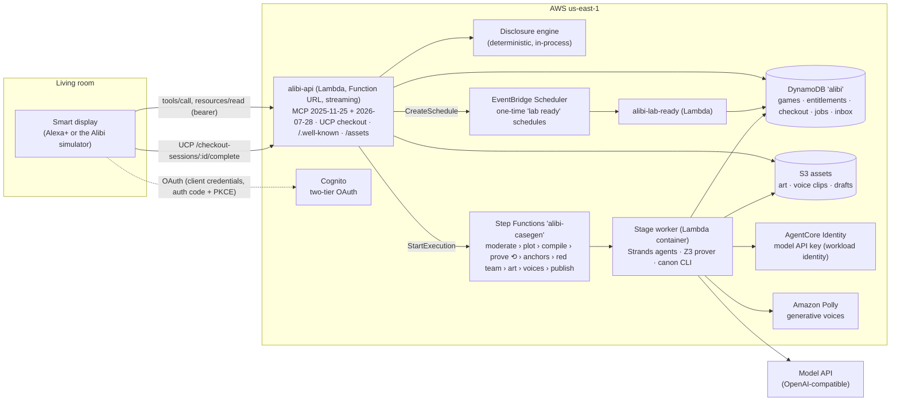

# Architecture

## The hot path: no model in a tool

Every tool call is answered by the deterministic disclosure engine in `packages/canon`. A call
runs in four steps:

1. Read the game from DynamoDB.
2. Resolve the suspect, topic, place or item the host passed (case-insensitive names and aliases;
   free text goes through a BM25 topic index).
3. Apply the action (ask, examine, present, lab, hint, accuse).
4. Write the game back under an optimistic `version` check.

The response is the **performance brief** for the host plus a view model for the MCP App. Before
it leaves the server, the output guard scans it for the fingerprints of every fact the player
has not earned. On a hit, the server returns a deflection and leaves the state unchanged.

The host model is therefore never told the solution, a locked fact, or which of a suspect's
lines are false. Whatever an attacker says to it, it cannot repeat what it never received.

## What a suspect will say

| Tier | When the suspect says it |
|---|---|
| `open` | First time the player asks about the topic |
| `guarded` | When the player presses (second question on the topic) |
| `locked` | After its unlock conditions: evidence found or shown to them, a lab result, another fact known, or one of their lies broken |
| `never` | Only the ending says it |

Lies are served as ordinary statements until the player shows the evidence that exposes them.
Then the suspect cracks: their pre-written crack line plays in their own voice, and the facts
behind it become known.

## Proof that a case is fair

`casegen/alibi_casegen/prover.py` computes everything a player can ever learn: search every
place, show anything to anyone, use the lab, keep asking. It then encodes motive, means and
opportunity per suspect in Z3 and checks four things:

- exactly one suspect is proven and everyone else is ruled out;
- talking alone does not prove it;
- the minimal proof is needed;
- every lie can be exposed and every lock opened.

The canon property test plays thousands of random sessions per case, including injection
strings, and asserts the output guard never fires on the engine's own responses. The red-team CLI
runs the same check for any case file.

## Long work

- **Lab results** become ready at a game time (`availableAt`). A one-time EventBridge schedule
  drops a "lab results are in" item into the household inbox at the real moment. Demo
  households can skip the clock ahead.
- **Custom cases** are a Step Functions execution named after the job id (dispatch is idempotent).
  Each stage runs on one container image and passes the draft through S3. A failed proof loops
  back to compile up to three times, then fails the job visibly and refunds nothing silently:
  the household gets a `custom_failed` inbox item and keeps its credit.

## Packages

| Path | What it is |
|---|---|
| `packages/canon` | Case schema (zod), disclosure engine, output guard, lint, property tests, CLI (`lint`, `playtest`, `redteam`) |
| `packages/server` | MCP server (dual-era), auth gate, UCP merchant, stores (memory and DynamoDB), Lambda entries |
| `packages/apps` | MCP App views (Preact, single-file HTML) |
| `packages/host` | A minimal assistant host (model and MCP client tool loop), used by the simulator and the eval |
| `packages/simulator` | Web simulator of a smart display: voice, MCP Apps bridge, account linking, wallet phase, protocol inspector |
| `casegen` | Case generation pipeline (Strands agents, Z3 prover, art, Polly voices) for Lambda and Step Functions |
| `eval` | Adversarial evaluation against a full-case-in-prompt baseline |
| `skills/alibi-case-author` | Agent Skill for writing and validating cases |
| `cases` | Playable cases |
| `infra` | AWS CDK app |
